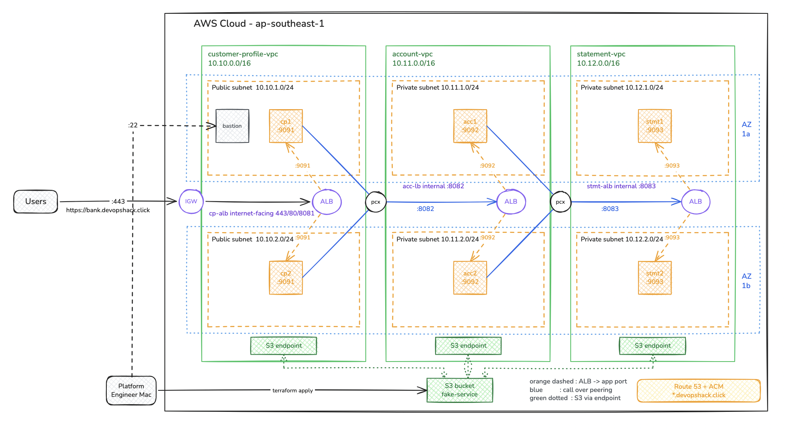
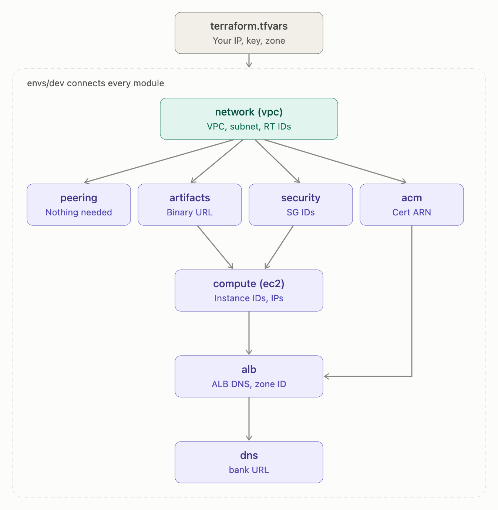
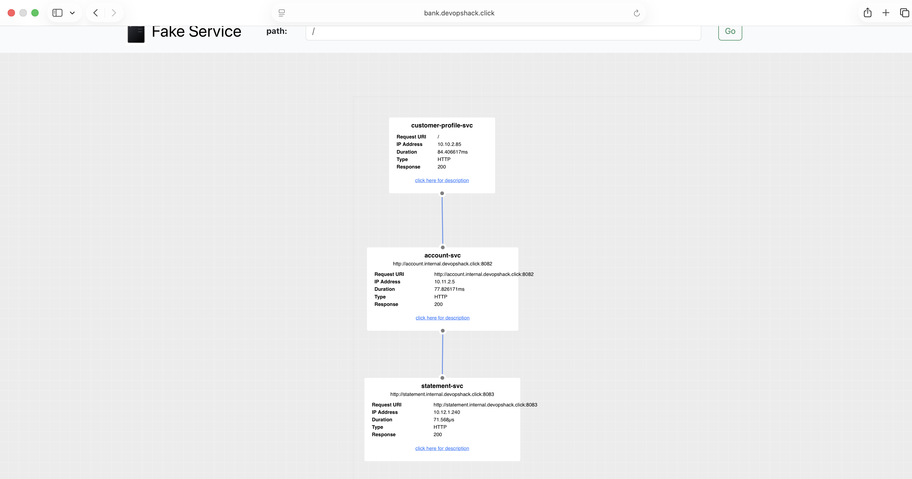

# cloudbank-lab

3-VPC chained peering lab on AWS, built with Terraform modules.

I first built this lab by hand in the console. After it worked, I moved everything into Terraform so I can bring the whole lab up and down with one command.

The app is [fake-service](https://github.com/nicholasjackson/fake-service). Each tier calls the next one, so one request goes through all 3 VPCs:

```
User -> customer-profile -> account -> statement
```

## Architecture



| VPC | CIDR | Subnets | App | ALB |
| --- | --- | --- | --- | --- |
| customer-profile-vpc | 10.10.0.0/16 | public 10.10.1.0/24, 10.10.2.0/24 | cp1, cp2 :9091 | cp-alb, internet-facing, 443 / 80 / 8081 |
| account-vpc | 10.11.0.0/16 | private 10.11.1.0/24, 10.11.2.0/24 | acc1, acc2 :9092 | acc-lb, internal, 8082 |
| statement-vpc | 10.12.0.0/16 | private 10.12.1.0/24, 10.12.2.0/24 | stmt1, stmt2 :9093 | stmt-alb, internal, 8083 |

Peering:

- `pcx-cp-acc` : customer-profile <-> account
- `pcx-acc-stmt` : account <-> statement
- No peering between customer-profile and statement. Peering is not transitive, so cp can never reach stmt directly.

DNS (Route 53 zone `devopshack.click`):

- `bank.devopshack.click` -> cp-alb
- `account.internal.devopshack.click` -> acc-lb
- `statement.internal.devopshack.click` -> stmt-alb

The app servers have no internet access. They get the fake-service binary from a private S3 bucket through an S3 gateway endpoint in each VPC. The bucket policy only allows downloads from those endpoints.

## Folder structure

```
cloudbank-lab/
├── envs/
│   └── dev/
│       ├── backend.tf
│       ├── providers.tf
│       ├── variables.tf
│       ├── terraform.tfvars      (not in git)
│       ├── network.tf            vpc, peering, artifacts
│       ├── security.tf           security groups
│       ├── compute.tf            ec2 + startup scripts
│       ├── loadbalancer.tf       alb
│       ├── dns.tf                acm, dns
│       └── outputs.tf
├── modules/
│   ├── vpc/
│   ├── vpc-peering/
│   ├── security-group/
│   ├── ec2/
│   ├── alb/
│   ├── acm/
│   ├── dns/
│   └── artifacts/
├── templates/
│   └── fake-service.sh.tftpl
├── scripts/
│   └── get-fake-service.sh
└── docs/
    ├── architecture.png
    ├── module-flow.png
    └── fake-service-ui.png
```

Each module folder has `main.tf`, `variables.tf` and `outputs.tf`.

- `modules/` describe what to build. No provider, no state.
- `envs/dev/` is the root module. It has the provider and the state, and it connects the modules together.
- `templates/` has one startup script. Each tier fills in its own port, name and upstream.

## How the modules pass values

Modules don't talk to each other. `envs/dev` takes outputs from one module and passes them into the next.



Each box shows what that module gives to the next one. network also passes subnet and VPC IDs straight to compute and alb. I left those arrows out to keep the picture clean.

Build order comes from these references. Terraform works it out by itself:

1. VPCs
2. Peering, S3, security groups, ACM cert
3. EC2
4. ALBs
5. DNS records

## How to run

Things that must already exist in the account:

- Route 53 hosted zone `devopshack.click`
- an EC2 key pair in ap-southeast-1

Steps:

```bash
# 1. get the fake-service binary (saved to bin/, not in git)
./scripts/get-fake-service.sh

# 2. aws profile
export AWS_PROFILE=ncloud-master
export AWS_REGION=ap-southeast-1

# 3. your values
cd envs/dev
cat > terraform.tfvars <<EOF
my_ip    = "$(curl -s https://checkip.amazonaws.com)/32"
key_name = "<your-key-pair>"
EOF

# 4. deploy
terraform init
terraform plan -out=tfplan
terraform apply tfplan
```

Apply takes about 5 to 10 minutes. Wait a few more minutes for the instances to boot.

## Test

```bash
curl https://bank.devopshack.click
```

You should get nested JSON: customer-profile-svc -> account-svc -> statement-svc, all `"code": 200`.

UI: https://bank.devopshack.click/ui/



Other checks I did:

| Test | Command | Expected |
| --- | --- | --- |
| HTTP redirect | `curl -I http://bank.devopshack.click` | 301 to https |
| No cp -> stmt | `ssh cp1 "curl -m 5 http://statement.internal.devopshack.click:8083"` | timeout |
| acc -> stmt works | `ssh acc1 "curl http://statement.internal.devopshack.click:8083"` | 200 |
| Failover | `ssh stmt1 "sudo systemctl stop fake"` | traffic moves to stmt2 |
| Internal ALB not public | `curl -m 5 http://account.internal.devopshack.click:8082` from my Mac | timeout |

## SSH

Get the IPs with `terraform output`, then in `~/.ssh/config`:

```
Host bastion
  HostName <bastion_public_ip>
  User ubuntu
  IdentityFile ~/.ssh/<key>.pem

Host cp1 cp2 acc1 acc2
  User ubuntu
  IdentityFile ~/.ssh/<key>.pem
  ProxyJump bastion

Host stmt1 stmt2
  User ubuntu
  IdentityFile ~/.ssh/<key>.pem
  ProxyJump bastion,acc1
```

stmt needs 2 jumps because there is no peering between cp and stmt.

## Clean up

```bash
terraform destroy
```

ALBs and EC2 cost money per hour, so I destroy after each session.

## Notes

- State is local for now. Plan is to move it to HCP Terraform later. The binary upload reads `bin/fake-service` from my Mac, so that part needs to change before remote runs.
- The vpc module uses `terraform-aws-modules/vpc/aws` 6.7.3. It creates one private route table per subnet, so the peering routes are added to both.
- `terraform.tfvars`, state files and `bin/` are in `.gitignore`.
